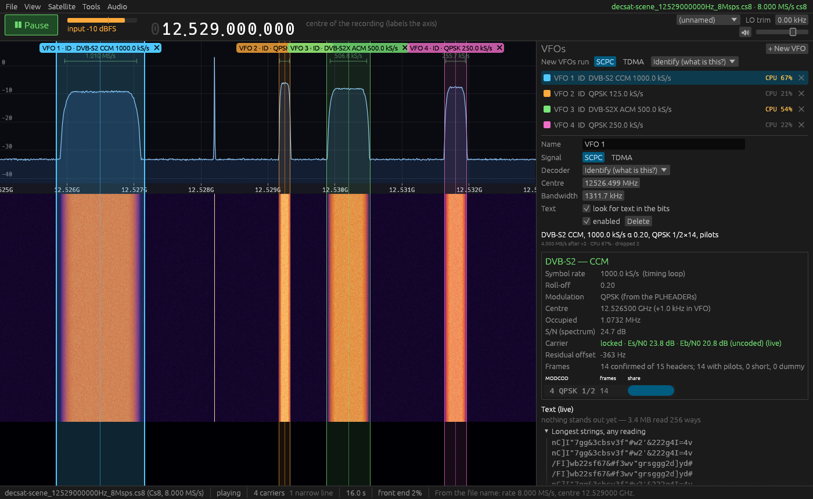

<!-- made by CasualArclamp -->
# DecSAT

[](https://github.com/CasualArclamp/DecSAT/releases/latest) [](https://github.com/CasualArclamp/DecSAT/releases)

If DecSAT is useful to you, you can [donate with PayPal](https://www.paypal.me/Arclamp).

DecSAT is a **satellite receiver** written in Rust. It uses a
software-defined radio or an IQ recording. The window shows a waterfall of
the full span, as SDR++ does. You put VFOs on the waterfall, and each VFO
runs one decoder. The **Identify** decoder measures an unknown carrier and
tells you its signal type.

The name of the project was **DecDVB** until October 2026.



*A test scene (`decsat scene`) with five carriers. DecSAT found and
identified each carrier without help.*

> DecSAT is in early development. [`docs/DESIGN.md`](docs/DESIGN.md) gives
> the scope and the plan. [`docs/STATUS.md`](docs/STATUS.md) gives the work
> that is complete.

## What it decodes

| Signal | What you get |
|---|---|
| **DVB-S2 and DVB-S2X**: CCM, ACM, VL-SNR, multistream, superframes | GSE to IP (PCAP, live Wireshark), MPEG-TS (file, UDP, HTTP, player in the app), multicast audio and TV, BISS mode 1 descrambling |
| **DVB-S** | MPEG-TS |
| **DVB-RCS and DVB-RCS2** signalling, return pools | The signalling tables, the burst plans and the bursts of the terminals |
| **SCPC modems**: Intelsat TPC 2964, Comtech TPC 7/8, Comtech CDM-570L and CDM-600L, Paradise Q-Flex FastLink, K = 7 Viterbi (IESS-308/309) | IP, MPEG-TS, E1, voice (G.711, G.728), apt-X programme audio |
| **Radar feeds** (IBM bisync, ASTERIX 034, 048 and 021) and **ED-137** radio | A track table, a radar scope with a map, the radio voice |
| **DVB-CID** carrier ID | The modulator ID, position, telephone number and text |
| **TDMA bursts**, the Intelsat 19 DAMA outbound | The burst layout, slots, frames and terminals; the call signalling |
| **Satellite beacons** | Frequency, drift and C/N0; telemetry frames (IRIG 106, CCSDS) |
| **Inmarsat** Classic Aero and GMR-2+ (IsatPhone) | ACARS, ADS-C and voice; sync and System Information |
| **QO-100 PSK beacon**, Barker-11 spread BPSK, NovelSat NS4 (eight QPSK modes) | Frames, text and BBFRAMEs |
| **Other PSK, APSK and QAM carriers** | A symbol file and a text search |

Other tools: **Survey** tries each carrier in the span and makes a list.
You can also record IQ, load a frequency plan, save snapshots and write a
session log.

[`docs/manual/features.md`](docs/manual/features.md) gives the full list and
the test status of each item.

## Radios

| Source | Notes |
|---|---|
| HackRF One | 2 to 20 MS/s. Rust driver, no DLL |
| Fobos SDR (RigExpert) | 8 to 50 MS/s. Uses the RigExpert library |
| Airspy Mini, Airspy R2, HydraSDR RFOne | 2.5 to 10 MS/s. Rust driver, no DLL |
| ADALM-PLUTO, Pluto+, LibreSDR | 0.26 to 61.44 MS/s, USB or network. Not tested on hardware |
| SDRplay, RTL-SDR, UHD | Set them in the radio window |
| Network IQ | SDR++, GNU Radio, rtl_tcp. TCP or UDP |
| IQ files | `cs8`, `cu8`, `cs16`, `cs24`, `cf32`, and `.wav` with two channels |
| `decsat-server` | A radio on a different computer. See [`docs/REMOTE.md`](docs/REMOTE.md) |

[`docs/manual/radios.md`](docs/manual/radios.md) gives the settings, the
gain advice and the bias tee limits for each radio.

## Install

Download the [latest release](https://github.com/CasualArclamp/DecSAT/releases/latest),
or build DecSAT from the source. To build, you must have Rust 1.95 or newer,
a C compiler and CMake.

```bash
git clone --recurse-submodules https://github.com/CasualArclamp/DecSAT
cargo build --release
```

In a clone that you already have, `git submodule update --init` gets the
submodules.

## Quick start

1. Start the program with an IQ file, or start it and select a radio.

   ```bash
   cargo run --release -p decsat-gui -- capture_8Msps.cs8
   ```

2. If the waterfall does not move, push **▶ Start**. A green bracket shows
   each carrier that DecSAT found.
3. Click a green bracket. DecSAT identifies the carrier and starts the
   applicable decoder.
4. Read the result in the side bar.
5. Push **● Record** to write the output to a file. The default folder is
   `Documents\DecSAT`.

To make a VFO manually, drag on an empty area of the waterfall. Then select
the decoder in the side bar.

## Manual

| Page | Contents |
|---|---|
| [The window, Identify and Survey](docs/manual/using.md) | Mouse controls, the side bar, remote radios, Survey, the frequency plan, snapshots, the session log |
| [DVB](docs/manual/dvb.md) | DVB-S2 and DVB-S2X to IP or MPEG-TS, DVB-RCS, the TV player, BISS, multicast audio, DVB-S, DVB-CID |
| [Modems, voice and radar](docs/manual/modems.md) | TPC 2964, Comtech, voice on E1, the radar scope, NovelSat NS4, PSK to symbols, Barker-11 |
| [TDMA](docs/manual/tdma.md) | TDMA bursts, the Intelsat 19 DAMA outbound |
| [Beacons](docs/manual/beacons.md) | Satellite beacons and telemetry, the Ku-band beacon list, the QO-100 PSK beacon |
| [Inmarsat](docs/manual/inmarsat.md) | GMR-2+ and Classic Aero |
| [Transmit](docs/manual/transmit.md) | The transmit panel and the `decsat-tx` application |
| [Command line](docs/manual/cli.md) | Examples of `decsat` commands |
| [Radios](docs/manual/radios.md) | HackRF One, Fobos SDR, Airspy, Pluto |
| [Features](docs/manual/features.md) | The full feature list with the test status |
| Signal gallery ([file](docs/signal-gallery.html), [view](https://htmlpreview.github.io/?https://github.com/CasualArclamp/DecSAT/blob/main/docs/signal-gallery.html)) | How each signal type looks on the waterfall and in the constellation |
| RCS field guide ([file](docs/rcs-field-guide.html), [view](https://htmlpreview.github.io/?https://github.com/CasualArclamp/DecSAT/blob/main/docs/rcs-field-guide.html)) | How to identify satellite return links |
| [Test signals](tests/README.md) | How to make the test signals |

## Transmit

DecSAT can transmit a DVB-S2 or DVB-S2X carrier from an MPEG-TS, a camera or
a test pattern. The output is a HackRF One or an IQ file.

**The radio transmits only after you arm it and push Transmit.** The gain
starts at 0 dB and the amplifier starts off at each start. Use a cable with
an attenuator, or a dummy load. Do not transmit into an antenna unless you
have a licence for the frequency and the power. See
[`docs/manual/transmit.md`](docs/manual/transmit.md).

## Scope

DecSAT does all that one HackRF One can receive:

- Symbol rates to approximately 15 MS/s.
- Normal, short and medium FECFRAMEs.
- All DVB-S2 and DVB-S2X MODCODs to 256APSK.
- VL-SNR with pi/2-BPSK.
- Roll-off values from 0.35 to 0.05.
- Superframes (Annex E), multistream (ISI) and the gold-code index.

Channel bonding (Annex D) and wideband time-slicing (Annex M) are not in the
scope. They use more spectrum than one HackRF has. Wide broadcast
transponders (27 to 45 MS/s) are too fast for the USB link of the HackRF.
DecSAT decodes them only from IQ recordings.

## Credits

Written from ETSI **EN 302 307-1** (DVB-S2) and **EN 302 307-2** (DVB-S2X), with
algorithms studied from and credited to:

- [gr-dvbs2rx](https://github.com/igorauad/gr-dvbs2rx) (GPL-3) — PL framing,
  frame sync, LDPC/BCH
- [leansdr / leandvb](https://github.com/pabr/leansdr) (GPL-3) — constellations
- [gr-dtv](https://github.com/gnuradio/gnuradio) (GPL-3) — modulator reference
- [dontlookup](https://github.com/ucsdsysnet/dontlookup) (MIT) — GSE/IP
  de-encapsulation, including the proprietary header-length and split
  fragment-ID variants found on real carriers
- [FFmpeg](https://ffmpeg.org) libavcodec's aptX decoder (© 2017 Aurelien
  Jacobs, LGPL-2.1-or-later) — the apt-X and aptX HD tables, ADPCM and QMF,
  ported to Rust and bit-exact against it
- [VLC](https://www.videolan.org) (`modules/demux/mpeg/csa.c`, Laurent
  Aimar) and [libdvbcsa](https://www.videolan.org/developers/libdvbcsa.html)
  (both GPL-2.0-or-later) — the DVB-CSA tables and round structure for BISS
  descrambling, checked bit-exact against VLC
- DecDRM — the waterfall's GPU ring texture
- [libiio](https://github.com/analogdevicesinc/libiio) v0.25/0.26 (Analog
  Devices, LGPL-2.1) — the IIOD protocol and context XML the Pluto driver
  speaks, re-implemented in Rust; F5OEO's Tezuka firmware and
  SoapyPlutoPAPR — the 8-bit IQ mode and how to detect it
- [VK2SWL DVB-S/S2 Multicast Audio Receiver](https://github.com/VK2SWL/DVB-S-S2-Multicast-Audio-Receiver)
  — the idea for the multicast audio function
- [DecAero](https://github.com/CasualArclamp/DecAero) — the Inmarsat Aero
  receiver

The in-app TV player runs [FFmpeg](https://ffmpeg.org) as a separate
program, when it is installed; DecSAT does not include it.

The radar scope draws OpenStreetMap's tiles (© OpenStreetMap contributors,
ODbL; credited on the map), OurAirports' airport and runway data (public
domain) and, when you switch it on, aircraft from adsb.lol (ODbL). ASTERIX
is read from EUROCONTROL's category specifications, the Mode S registers
from ICAO Doc 9871.

## Licence

GPL-3.0-or-later. See [LICENSE](LICENSE).
