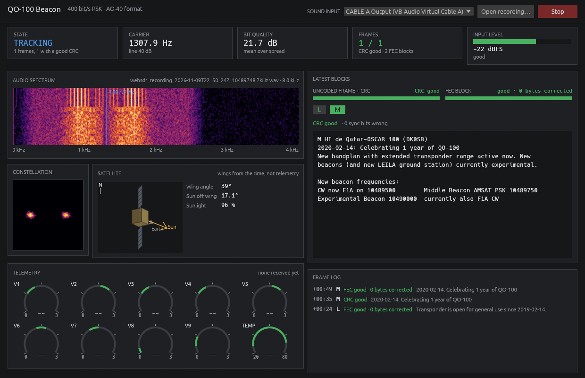

<!-- made by CasualArclamp -->
# DecSAT manual: Satellite beacons

This page describes the beacon decoders. [Back to the README](../../README.md).

## Satellite beacons

A satellite's beacon is the carrier ground stations point at and measure
the path by, and often carries the spacecraft's telemetry. Drop a VFO on
one wide enough for its sidebands (claim the narrow line from its bracket
and the VFO is widened to 200 kHz by itself) and choose **Satellite
beacon**:

- **the carrier**: found as the strongest narrow line (the one at the VFO's
  centre first), tracked by a phase-locked loop sized to its C/N0; the card
  gives its frequency as received (tuning + LNB + VFO + loop), its drift
  over the last minute, C/N0 and level, with charts of both against time —
  for pointing, rain fade and LNB drift. A beacon with nothing on it reads
  *unmodulated (CW)* after five looks;
- **the telemetry**, all blind: a **data subcarrier** BPSK-modulated and
  phase-modulating the carrier (PCM/PSK/PM) is found from the line the
  squared phase shows at twice its frequency, and taken to baseband by a
  Costas loop; **data straight on the phase** (PCM/PM, bi-phase) from the
  phase's own spectrum; a carrier with **no residual line** is demodulated
  as BPSK or QPSK. The bit rate comes from the data's transitions,
  **bi-phase** (Manchester) is told from NRZ by its chips, and the
  modulation index from the share of power the carrier keeps;
- **the frames**: on IRIG 106's sync words (FAF320, FE6B2840, EB90),
  CCSDS's marker (1ACFFC1D) or, failing those, a word found blind from the
  frame period, in any polarity and as sent or differentially coded
  (NRZ-M/S, bi-phase-M/S); bit slips and missed words ridden out. The
  **minor-frame counter** is found and the **major frame** drawn as a map —
  a row a minor frame, a column a byte, grey where a word never changes and
  coloured by value where it does; **click a cell** to plot that word (or a
  16-bit word, signed or not) against time — or that byte in **every minor
  frame**, a line each — and **Pin** the plot to keep it on the card (pins
  are remembered between runs). A check byte at the frame's end and a
  spacecraft clock are found by themselves; frames failing the check are
  kept out of the map and plots. The latest frame is shown in hex, the sync
  word and counter picked out;
- **CCSDS**: when the frames start with the marker, the codeblock's layout
  is worked out — Reed–Solomon (255,223) or (255,239) in the dual basis,
  interleave 1–8, virtual fill, the randomiser — and the TM or AOS
  transfer frames read: spacecraft, virtual channels, counts, the frame
  CRC. CCSDS's K = 7 code is recognised by its parity checks in the first
  fifth of a second of bits (inverted or not, either output first, either
  pair phase) and decoded from there; bits that frame on nothing are
  tried through every reading of it as well;
- **♪ Pointing tone**: a tone whose pitch follows the C/N0 a tenth of a
  second at a time — two semitones a dB up from 600 Hz at the level when it
  was switched on (**re-centre** to start again) — so the dish can be
  peaked by ear;
- **where to look**: the subcarrier is found blind, or set by hand — its
  offset from the carrier (0 for data on the carrier's phase), how far its
  data reach either side, and the bit rate — in the VFO's settings, or by
  dragging the dashed **TLM** marks either side of the carrier on the
  waterfall. A subcarrier placed by hand snaps to its own line nearby.

**Tools ▸ Beacons…** lists the Ku-band beacons of the geostationary arc,
all the way round — 274 satellites, 238 of them with beacons, 110–180°E
researched October 2026 and the rest of the arc November 2026: the
operators' own figures where they publish them (Optus's payload documents,
FCC grants and STAs for Intelsat, SES, EchoStar, Telstar and Eutelsat
satellites), community lists
(satbeams, frequencyplansatellites, reception reports) marked
*unconfirmed* otherwise, and the satellites whose beacons are not published
at all. Click a frequency to retune the radio there and put a beacon VFO on
it; the chosen satellite's beacons (by name, or by a position such as
`160` or `30W`) are marked on the waterfall. Type **My location**
(`-27.47, 153.03`, `51.5N 0.12W`, or just a longitude such as `153`) in
the window and the list keeps to the satellites within its limits — at
least **min el** up (10° by default) and no more than **max az ±** off due
south, or due north below the equator (75° by default; 90° is off) — with
their elevation and azimuth, and **All beacons** marks only those, so a
beacon on the same frequency on the far side of the world is never matched. The list is
`apps/decsat-gui/src/ku_beacons.csv`.


*The beacons window for two locations: only the satellites in view, with
their elevation, azimuth and beacon frequencies.*

**📡 All beacons** (beside the volume) marks every satellite's beacons at
once, to find a satellite or check which one the dish is on: a mark with a
narrow line within 100 kHz of it (and nearer it than any other listed
beacon) is drawn bright, one without dim, and the satellite whose beacons
have the lines is named beside the button — *Intelsat 19 · 5 of 5*, or
*Koreasat 7 or Eutelsat 172B · 1 of 1* where satellites list the same
frequency. Only beacons on the polarisation of the lit ones count against
a satellite. Most of these satellites keep a beacon at 12.20–12.26 or
12.75 GHz; hover a mark for its satellite, frequency and source.

**● Record** writes the frames raw to `decsat-<VFO>-<RF>MHz-beacon-<time>.bin`
(one after another), a line each (time, counter, hex) to the `.csv` beside
it, and the carrier's log (offset, C/N0, level every half second) to a
`.level.csv`. On the Intelsat 19 beacon at 12 253.47 MHz: C/N0 58 dB-Hz,
index 1.2 rad, 4800 bit/s bi-phase on a 48 kHz subcarrier, 2048-bit frames
on FAF320 with a counter 0–31 in byte 4 (a 13.65 s major frame). On
Eutelsat 172B's at 12 250.10 MHz: C/N0 58 dB-Hz, index 1.2 rad, 9600
symbol/s NRZ on a 76.8 kHz subcarrier under CCSDS's K = 7 code, one
596-byte TM frame a second on the marker (no Reed–Solomon or randomiser,
frame CRC), spacecraft 2DFh. What the words mean is the spacecraft maker's;
nothing here guesses.

Identify names a beacon (*Satellite beacon — residual carrier, PCM/PSK/PM —
subcarrier 48.000 kHz, 4800 bit/s bi-phase*) and the survey and the scan
hand it to this decoder. A VFO over one sideband of a subcarrier alone sees
BPSK bi-phase chips, and Identify says so rather than calling them a code.

```bash
decsat decode beacon_533333Sps.cf32 --decoder beacon   # carrier, telemetry, frames, the last few in hex
```

## QO-100's PSK beacon

Decoder **AMSAT PSK beacon** (`p3` on the command line): a VFO a few kHz wide
on 10489.750 MHz, or on a receiver's audio. A mono WAV (a WebSDR's recording)
opens as a capture:

```bash
decsat decode recording.wav --decoder p3 --bandwidth 8000 --fast
```

**`qo100-beacon.exe`** is the same receiver on its own, for a sound card:
pick the input (or a virtual cable from a WebSDR or SDR program), press
Listen, and tune USB so the beacon is somewhere between 300 Hz and 3.7 kHz.
It shows the waterfall, the constellation, the latest of each block, a log of
every frame and the housekeeping values. A frame takes 10.4 s and they come
every 25 s.



*`qo100-beacon.exe` on a WebSDR recording: the beacon's text blocks, with
every frame's CRC good.*

As received in November 2026 the beacon sends text only: the K block, which
carried uptime, temperature and voltages in 2019, is blank. They will show
if it sends them again.
