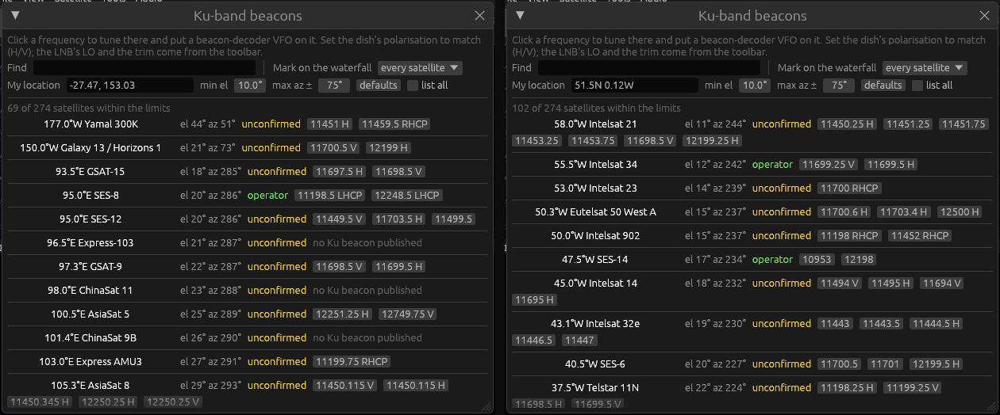

<!-- made by CasualArclamp -->
# DecSAT manual: Satellite beacons

This page describes the beacon decoders. [Back to the README](../../README.md).

## Satellite beacons

A beacon is a carrier that a satellite transmits. Ground stations point
their antennas at the beacon and use it to measure the path. A beacon
frequently carries the telemetry of the spacecraft.

To decode a beacon:

1. Put a VFO on the beacon. Make the VFO sufficiently wide for the
   sidebands of the beacon.
2. Select **Satellite beacon** as the decoder.

If you claim the narrow line from its bracket, DecSAT automatically makes
the VFO 200 kHz wide.

**The carrier**

- The decoder finds the carrier as the strongest narrow line. It looks
  first at the line at the centre of the VFO.
- A phase-locked loop tracks the carrier. The decoder sets the loop
  bandwidth from the C/N0 of the carrier.
- The card gives the frequency as received (tuning + LNB + VFO + loop).
- The card gives the drift during the last minute, the C/N0 and the level.
- The card shows charts of the C/N0 and the level against time. Use them
  for antenna pointing, rain fade and LNB drift.
- If a beacon has no modulation, the card shows *unmodulated (CW)* after
  five looks.

**The telemetry**

The decoder finds the telemetry without help. There are three types:

- **Data subcarrier** (PCM/PSK/PM). The data BPSK-modulates a subcarrier,
  and the subcarrier phase-modulates the carrier. The squared phase shows a
  line at two times the subcarrier frequency. The decoder finds the
  subcarrier from this line. A Costas loop then moves the subcarrier to
  baseband.
- **Data straight on the phase** (PCM/PM, bi-phase). The decoder finds the
  data from the spectrum of the phase.
- **No residual line**. The decoder demodulates the carrier as BPSK or
  QPSK.

The decoder also measures these values:

- The bit rate, from the transitions of the data.
- **Bi-phase** (Manchester) or NRZ, from the chips.
- The modulation index, from the part of the power that stays in the
  carrier.

**The frames**

The decoder looks for a sync word in this sequence:

1. The sync words of IRIG 106 (FAF320, FE6B2840, EB90).
2. The marker of CCSDS (1ACFFC1D).
3. A word that the decoder finds from the frame period without help.

The decoder tries each polarity. It tries the bits as sent and with
differential decoding (NRZ-M/S, bi-phase-M/S). The decoder continues
through bit slips and missed sync words.

The decoder finds the **minor-frame counter**. It then shows the **major
frame** as a map:

- Each row is a minor frame.
- Each column is a byte.
- A cell is grey where the word does not change.
- A cell has a colour for its value where the word changes.

You can use the map as follows:

- **Click a cell** to make a plot of that word against time. You can also
  plot a 16-bit word, signed or unsigned.
- You can plot that byte in **every minor frame**, with one line for each
  minor frame.
- Push **Pin** to keep the plot on the card. DecSAT keeps the pins between
  runs.

The decoder automatically finds a check byte at the end of the frame and a
spacecraft clock. The map and the plots do not include frames that fail
the check. The card shows the latest frame in hex and identifies the sync
word and the counter.

**CCSDS**

When the frames start with the marker, the decoder finds the layout of the
codeblock:

- Reed–Solomon (255,223) or (255,239) in the dual basis.
- Interleave 1–8.
- Virtual fill.
- The randomiser.

The decoder then reads the TM or AOS transfer frames. It shows the
spacecraft, the virtual channels, the counts and the frame CRC.

The decoder recognises the K = 7 code of CCSDS from its parity checks. It
uses the first fifth of a second of the bits. It tries these conditions:

- Inverted or not inverted.
- Each of the two outputs first.
- Each of the two pair phases.

The decoder then decodes the bits from that point. If the bits do not
give frames, the decoder also tries each of these conditions on them.

**♪ Pointing tone**

The pointing tone is a tone with a pitch that follows the C/N0. The pitch
changes each tenth of a second. The tone is 600 Hz at the level when you
set it to on. The pitch goes up two semitones for each dB. Push
**re-centre** to start again from 600 Hz. Thus you can peak the dish by
ear.

**Where to look**

The decoder finds the subcarrier without help. You can also set these
values manually:

- The offset of the subcarrier from the carrier. Use 0 for data on the
  phase of the carrier.
- The distance that the data occupy on each side of the subcarrier.
- The bit rate.

Set these values in the settings of the VFO. Alternatively, drag the
dashed **TLM** marks on each side of the carrier on the waterfall. A
subcarrier that you put manually moves to its own line if the line is
near.

**Tools ▸ Beacons…**

This window lists the Ku-band beacons of the full geostationary arc. The
list has 274 satellites, and 238 of them have beacons. The research for
110–180°E was done in October 2026. The research for the remaining part of
the arc was done in November 2026. The list is
`apps/decsat-gui/src/ku_beacons.csv`.

The data come from these sources:

- The figures of the operators, where the operators publish them. These
  are the payload documents of Optus, and FCC grants and STAs for Intelsat,
  SES, EchoStar, Telstar and Eutelsat satellites.
- Community lists (satbeams, frequencyplansatellites, reception reports).
  The list shows these as *unconfirmed*.
- The list also includes the satellites that have no published beacons.

Click a frequency. DecSAT tunes the radio to that frequency and puts a
beacon VFO on it. The waterfall shows marks for the beacons of the
satellite that you select. Select the satellite by name, or by a position
such as `160` or `30W`.

Type **My location** in the window. Examples are `-27.47, 153.03`,
`51.5N 0.12W`, or only a longitude such as `153`. The list then shows only
the satellites that are in these limits:

- The elevation is a minimum of **min el** (10° by default).
- The azimuth is a maximum of **max az ±** from south (75° by default; 90°
  is off). South of the equator, the reference is north.

The list gives the elevation and the azimuth of each satellite. **All
beacons** then marks only those satellites. Thus DecSAT does not match a
beacon on the same frequency from a satellite that is not in view.



*The beacons window for two locations. Each window shows only the
satellites in view, with their elevation, azimuth and beacon frequencies.*

**📡 All beacons**

This button is adjacent to the volume control. It marks the beacons of all
the satellites at the same time. Use it to find a satellite, or to make
sure which satellite the dish points at.

- A mark is bright if a narrow line is less than 100 kHz from it. The line
  must also be nearer to this mark than to all other listed beacons.
- A mark without such a line is dim.
- DecSAT shows the name of the satellite whose beacons have the lines
  adjacent to the button. An example is *Intelsat 19 · 5 of 5*.
- Where satellites list the same frequency, DecSAT shows all of them. An
  example is *Koreasat 7 or Eutelsat 172B · 1 of 1*.
- For each satellite, DecSAT counts only the beacons on the polarisation
  of the beacons that have lines.

Most of these satellites have a beacon at 12.20–12.26 or 12.75 GHz. Hold
the pointer on a mark to see its satellite, frequency and source.

**● Record**

**● Record** writes these files:

- `decsat-<VFO>-<RF>MHz-beacon-<time>.bin`: the raw frames, in sequence.
- A `.csv` file with the same name: one line for each frame (time,
  counter, hex).
- A `.level.csv` file: the log of the carrier (offset, C/N0 and level each
  half second).

Results on the Intelsat 19 beacon at 12 253.47 MHz:

- C/N0 58 dB-Hz, index 1.2 rad.
- 4800 bit/s bi-phase on a 48 kHz subcarrier.
- 2048-bit frames on FAF320.
- A counter 0–31 in byte 4 (a 13.65 s major frame).

Results on the Eutelsat 172B beacon at 12 250.10 MHz:

- C/N0 58 dB-Hz, index 1.2 rad.
- 9600 symbol/s NRZ on a 76.8 kHz subcarrier, with the K = 7 code of
  CCSDS.
- One 596-byte TM frame each second on the marker.
- No Reed–Solomon and no randomiser. The frames have a frame CRC.
- Spacecraft 2DFh.

Only the manufacturer of the spacecraft knows the function of the words.
DecSAT does not guess it.

**Identify**

Identify gives the name of a beacon. An example is *Satellite beacon —
residual carrier, PCM/PSK/PM — subcarrier 48.000 kHz, 4800 bit/s
bi-phase*. The survey and the scan give the beacon to this decoder.

A VFO on only one sideband of a subcarrier sees BPSK bi-phase chips.
Identify tells you this. It does not report the chips as a code.

```bash
decsat decode beacon_533333Sps.cf32 --decoder beacon   # carrier, telemetry, frames, the last few in hex
```

## QO-100's PSK beacon

The decoder is **AMSAT PSK beacon** (`p3` on the command line). Put a VFO
that is some kHz wide on 10489.750 MHz. You can also use the audio of a
receiver. A mono WAV (a recording from a WebSDR) opens as a capture:

```bash
decsat decode recording.wav --decoder p3 --bandwidth 8000 --fast
```

**`qo100-beacon.exe`** is the same receiver as a separate program, for a
sound card. To use it:

1. Select the input. The input can be a virtual cable from a WebSDR or an
   SDR program.
2. Push Listen.
3. Tune in USB until the beacon is between 300 Hz and 3.7 kHz.

The program shows these items:

- The waterfall.
- The constellation.
- The latest of each block.
- A log of every frame.
- The housekeeping values.

A frame has a duration of 10.4 s. The satellite sends a frame each 25 s.


*`qo100-beacon.exe` on a WebSDR recording. It shows the text blocks of the
beacon, and the CRC of every frame is good.*

As received in November 2026, the beacon sends only text. The K block is
blank. In 2019, the K block carried the uptime, the temperature and the
voltages. The program will show these values if the beacon sends them
again.
