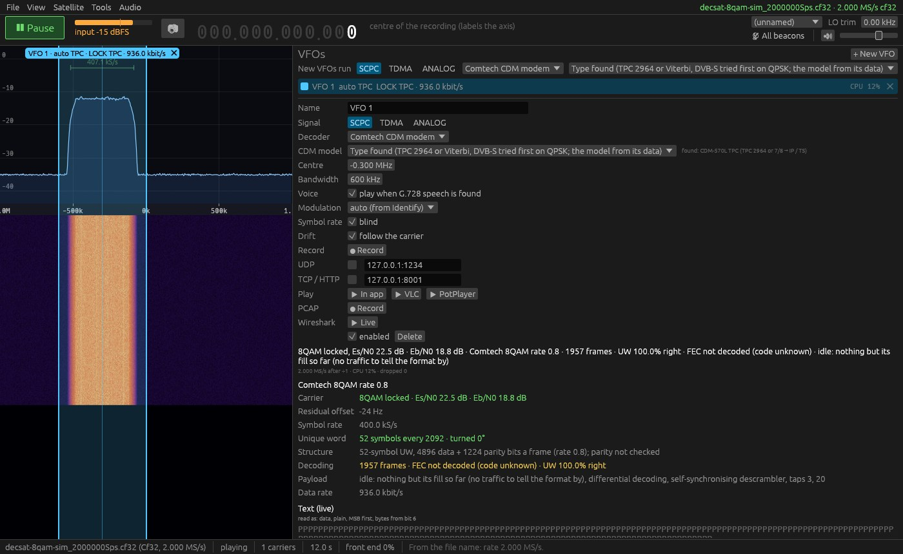
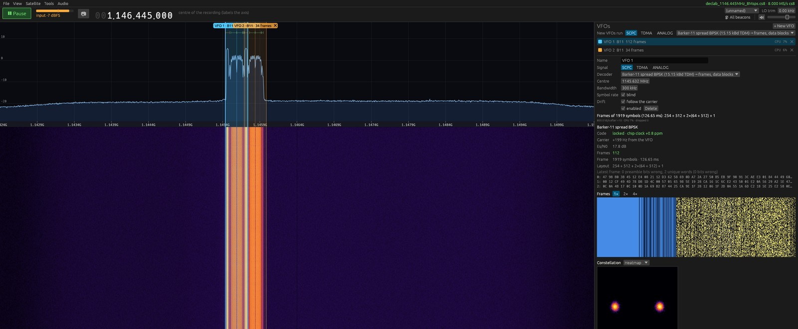

<!-- made by CasualArclamp -->
# DecSAT manual: SCPC modems, voice, radar and other carriers

This page describes the modem decoders and the data that they find. [Back to the README](../../README.md).

## TPC 2964 → IP / MPEG-TS

The rate-3/4 turbo product code of Intelsat IESS-315 VSAT carriers, as the
CTCOM RCV-20x manual describes it: frames of 2964 bits, a 20-bit unique word
F50B8h and a (64,57) × (46,39) extended-Hamming product codeword holding 2223
data bits, with a (2, 3, 9, 12) / 475h scrambler — on BPSK, QPSK or 8PSK
(Gray-labelled as the manual's Figure 3.1; on 8PSK a frame is 988 symbols
and its UW need not start on a symbol's first bit). IESS-315 itself sets
only performance and leaves the code to "compatible turbo modems", so the
VFO finds the rest from the signal:

1. **Unique word** every 2964 bits, under each carrier phase ambiguity; a
   carrier slip or a lost symbol is repaired at the next frame.
2. **Frame structure**: row or column order, either way round, the Hamming
   generator (all six degree-6 primitive polynomials), whether and how the
   code bits are scrambled — 432 combinations, judged by how many rows *and*
   columns are codewords as received (near all under the right one, 1 in
   128 under any other); close calls are settled by decoding.
3. **Decoding**: iterative Chase–Pyndiah soft decoding.
4. **Payload**: HDLC (FCS-16/32) or MPEG-TS, under each candidate
   descrambler — the (2, 3, 9, 12) polynomial self-synchronising or additive,
   ITU-T V.35's and V.29's — whichever yields frames that check.

**Comtech TPC 7/8** goes through the same decoder, which takes whichever
unique word it finds. Worked out from a live 171.43 kS/s QPSK carrier (no
document): frames of 16 320 bits (8160 QPSK symbols) — a 32-bit unique word
F8DD4258h and a (128,120) × (128,120) extended-Hamming product codeword
(generator x⁷ + x³ + 1, sent row by row), its first row's first 96 bits
shortened away; 14 304 data bits, of which the last 24 are overhead and the
rest — exactly 7/8 of the frame — the user's (300 kbit/s at 171.43 kS/s).
The data are scrambled by the same (2, 3, 9, 12) / 475h sequence, restarted
every frame one bit earlier than on TPC 2964.

**Comtech 8QAM, rate 0.8** also goes through the TPC decoder (Identify names
it and switches the demodulator to 8QAM). Worked out from a live, idle
427.28 kS/s carrier (no document): frames of 2092 symbols — a 52-symbol
BPSK unique word on two opposite corners of the 8QAM, then a systematic
codeword of 1632 data symbols (4896 bits, three a symbol, least significant
first) and 408 parity symbols; 1.000 Mbit/s at that rate. The data are
V.35-scrambled ahead of the encoder (HDLC idle flags on the carrier seen).
**The parity is not decoded**: on an idle carrier its code cannot be told
from the data, so the data bits pass on with the channel's errors. A
capture carrying traffic would let the code be found.



*Comtech 8QAM, rate 0.8, on a simulated carrier: locked, with the unique
word and the frame's structure in the card.*

IP found in the HDLC frames (Cisco HDLC, PPP, Frame Relay as RFC 2427
carries it, or anything with the packet after a short header) gets the same
statistics, PCAP and multicast audio as GSE — a flow whose UDP checksums all
fail while its headers check is marked **encrypted** in transit, and the
audio sniffer leaves it alone; a transport stream gets the TS outputs.
**● Record** writes the decoded data to a `.bin` (the IP has its own
*PCAP* and *Wireshark* buttons), and `decsat pcap` reads a recorded PCAP
back. Identify recognises the carrier by its unique
word. What each search found is shown, so you can tell a finding from a
default. It is confirmed on live Comtech CDM-600L and CDM-570L carriers.

**Comtech EDMAC with bridged Ethernet** (worked out from a live 8PSK
carrier; no specification was to hand): the data rate grown by 21/20 in
1008-bit frames — a fixed header, five 192-bit data blocks and 9-bit
overhead groups between them carrying the modems' M&C channel. Inside, the
traffic is bridged Ethernet in 258-byte packet blocks: a 4-byte word with a
pointer to where a packet ends, then packets, each with a length byte (or 0
for "to the pointer") and a 6-byte header. A packet with whole headers sets
up a header-compression context; the compressed packets that follow
(SNMP, the RTP of a radio-over-IP link, the middle fragments of its SIP)
are rebuilt from it — UDP checksums checked, fragments put back together by
the IP stage. The Ethernet frames go to the IP stage — statistics, PCAP —
like any other; the side panel's **Framing** and **Packets** rows say how it
is going.

**ED-137 radio over IP** (air traffic control radio as VoIP, wherever it
turns up in the IP): each RTP packet's header extension carries the radio's
signalling — PTT and its type (normal, coupling, priority, emergency,
test), squelch, the PTT's id, PTT mute and summation, simultaneous calls,
and features such as signal quality and CLIMAX delay — in R2S keep-alives
and voice packets alike. The IP card's **Radio over IP** section shows each
stream's state live (PTT red, squelch green), how often and how long each
was on, packets lost, and a log of the changes; the SIP dialogs that set the
sessions up are read too — who calls whom, the SDP (radio type, Tx/Rx mode,
keep-alive period, best-signal method) and whether the call was refused or
accepted (one direction tells it by the ACK's transaction). The field
layout follows Wireshark's ED-137 dissector, and agrees with tshark packet
for packet on a live recording. `decsat pcap … --radio-csv` writes every
packet's signalling. **The voice is heard**: the sound (G.711, A- or
µ-law) of packets whose PTT or squelch is on plays in the **Radio voice**
card as a call's does — by itself under the voice preset, one stream and
one talker at a time across the app, ▶ to listen regardless, ● to record a
`.wav` — with silence between transmissions.

## Voice over E1 (G.704, Comtech D&I++)

Modems carrying telephony or radio links (airband voice, for one) send
64 kbit/s G.711 channels: a whole E1, or — Comtech's **Drop & Insert++** —
the chosen timeslots in blocks of 2944 bits (64 overhead, 2880 data; the
layout is not published and was worked out from CDM-600L carriers: a 21-bit
sync and three bits that say whether the block starts a frame, then five
blocks of 72 bytes each after 10 bits of overhead — a block a timeslot
every 45 ms, the timeslots' bytes taking turns). Behind the TPC 2964
decoder the payload search finds either,
under the V.35 descrambler or any other it tries, and the **Voice** card
lists the channels with their levels: **▶** listens (the app's player and
volume), **●** records a `.wav`. A timeslot whose sign bit never changes is
not G.711 audio — sub-rate channels or compressed voice — and is marked
**not G.711** with the bits that do change; it plays as silence (as A-law
it would be loud digital noise), and so does any timeslot not yet judged.

When those bits carry **G.728** (LD-CELP, 16 kbit/s: a 10-bit codeword every
five samples), the card says **G.728 speech** and ▶/● play and record it
decoded; while someone speaks, the VFO lights up green with 🔊 in the
waterfall and the VFO list. The voice equipment behind a CDM-600L seen on Horizons 3e sends it
in bits 2–3 of its timeslot, framed G.728's own way (§3.11): the shape
index's top bit carries a sync bit, once every 20 ms different, which the
decoder locks to; its silence fill is muted, and recognised: a channel
sending it reads **G.728, silent** before anyone has spoken. The decoder is
written from the Recommendation and matches its Appendix I test vectors
(112 dB SNR or better).

**Multi-radio sites** send their timeslots differently: as HDLC packets on an
inverted line (idle flags read `00000011` repeated), each packet a sequence
count, a channel byte (`08h`–`F8h`), a type byte `13h` and 44 octets — 5.5 ms
— of one 64 kbit/s timeslot. Each channel's packets join into a continuous
timeslot, and the **Voice** card lists them by that byte (ch 10h, 18h, …)
and finds, plays and records the G.728 in each as above — a trunk's
timeslot can hold up to three G.728 channels in different bit pairs, each
decoded, and *one voice at a time* holds within the timeslot too. Packets
of another type on such a trunk carry the site's IP, which goes to the IP
stage (with the ADS-B in it: see below). A site with nothing to say sends
only a status packet every two seconds.

The **Comtech CDM modem** entry's voice models — CDM-600L voice, CDM-570L
trunk, or *type found*, which picks the chain from the first look and the
model from the data — play every channel with G.728 by itself.
**One voice at a time** (the Audio menu, on by default) works like a scanner's
hang time across all carriers and channels: whoever speaks first is heard,
and the others wait until they have been quiet for the **hold** (3 s, set
beside it); off, everyone is mixed. A channel played with ▶ is always heard.
The volume slider and 🔊 mute at the top right are the master for
everything played, and **Audio ▸ Output** picks the sound output (the system's default, or
any device by name — a headset, a virtual cable into other software);
players already running move to it at once, and the choice is remembered.
Offline:

```bash
decsat decode capture_148148Sps.cf32 --decoder tpc --out dir --e1-record 1
```

## Radar feeds and the radar scope

The same thin-route links carry air-traffic surveillance. Any VFO whose
chain yields the frames reads it (the **Comtech CDM modem** entry with *type
found* picks the chain itself; CDM-570L Viterbi and CDM-570L trunk are the
usual ones), in three forms:

- **Track reports in IBM bisync blocks** (SYN, an SOH heading, DLE STX … DLE
  ETX, a BCC) on a 9.6 kbit/s link: one message a sector, 32 a scan, each
  report a track's position, velocity, Mode A code, Mode C level and
  ground speed. The format is nobody's standard; it was worked out from
  the signal.
- **ASTERIX** in HDLC UI frames on 64 kbit/s links: category 034 service
  messages (sector crossings, the north marker with the radar's place and
  scan time) and category 048 target reports (position, Mode 3/A, flight
  level, Mode S address, track number, velocity, status), with the Mode S
  registers the radar reads from each aircraft (BDS 4,0, 5,0 and 6,0:
  selected altitude, altimeter setting, true track, heading, IAS, Mach,
  vertical rates). A block counts only if its records parse to its exact
  length under the standard UAPs.
- **ADS-B** as ASTERIX category 021 (edition 0.23) in a trunk's IP: each
  aircraft's own position, altitude, callsign, squawk and emitter class.

The VFO's **Radar feed** card lists the tracks; **📡 Radar scope** opens a
window with a PPI — the beam turning at the measured scan rate, range
rings, trails, one-minute leaders, Mode A / level / speed labels, hover
details, a track table, wheel zoom and drag pan. Click a track, or its row,
for its details: Mode S/A/C, climb or descent, speed and heading, range
and bearing from the radar and from the nearest airport, latitude and
longitude when the radar's place is known, the status word said field by
field, the raw octets. Coasted tracks are yellow; fast or high ones purple
(650 kt or more, FL450 or above, or over 350 kt below FL100); and with an
ADS-B feed in step with the radar's clock, the ADS-B aircraft are drawn over
the radar's picture as magenta diamonds at the places they report, and the
radar tracks no ADS-B aircraft matches turn red.

Under the PPI, **Map** draws OpenStreetMap tiles (fetched with the system's
`curl`, cached for good under `%APPDATA%\DecSAT`; **Light** or dark) and
**Airports** the airports and runways of OurAirports' open data (fetched
once, refreshed monthly). The radar's place comes from the feed when it
gives it (ASTERIX's north marker), else **Site…** sets it; either is kept in
your own settings, keyed by the radar, never in the project. Tracks the
feed leaves unnamed take callsigns from an ADS-B feed decoded on another
VFO (nothing asked of anyone) or, only with the **adsb.lol** switch on (off
by default), from that site's live aircraft near the radar. The waterfall
tags a carrier **ADS-B** or **RADAR** once a decoder has found either in it,
and remembers the carrier. While a VFO records, its track reports go to a
`.csv` beside the PCAP.

A CDM-570L trunk that carries a radar station's **monitoring and control**
multicast (Frame Relay; a word-oriented format of typed points, the units
named in the data) gets a **Radar station** card above the IP card, and
its scope shows the station's units and the readings that move beside the
PPI, with the targets of the radar feed another VFO decodes. What the
points mean is not known yet.

Offline, and unattended:

```bash
decsat decode radar_64000Sps.cf32 --decoder auto --fast      # a radar link: its reports
decsat payload trunk.bin --frame-bits 2223 --bit-rate 1024000 --radar-out tracks.csv --voice-out voice.wav   # a trunk's data recording
decsat pcap recording.pcap --csv points.csv                   # a recorded PCAP: the IP, a station's points
decsat-gui capture.cs8 --vfo-at 1461800:140000 --decoder trunk --radar-scope --radar-range 120 --after 20 --screenshot scope.png
```

## NovelSat NS4

A NovelSat modem in NS4 mode sends DVB-S2's frame — the same SOF and PLS
coding, slots, pilots, Gold-code scrambling, BBHEADER, baseband scrambling
and BCH code — with two things of its own: the PLS code numbers its modes
differently, and the LDPC codes are NovelSat's. Read as DVB-S2 such a
carrier locks under the wrong MODCOD name (QPSK 1/2 shows as *QPSK 2/3*) or
keeps losing lock, and every frame fails FEC. Nothing about NS4 is
published; what is here was measured from a modem.

Pick **NovelSat NS4 → GSE/IP (PCAP)** as the VFO's decoder (`--decoder ns4`
on `decsat decode`): the DVB-S2 decoder with the header read as NS4 means
it and NS4's LDPC codes, and everything after the BBFRAME as for DVB-S2.

```
decsat decode ns4_645161Sps.cf32 --decoder ns4 --symbol-rate 33000 --bandwidth 60000
```

| | PLS code (pilots off / on) | |
|---|---|---|
| QPSK 1/4 | 4 / 8 | ✅ |
| QPSK 1/2 | 21 / 25 | ✅ |
| QPSK 3/5 | 28 / 32 | ✅ |
| QPSK 2/3 | 33 / 37 | ✅ |
| QPSK 3/4 | 40 / 44 | ✅ |
| QPSK 5/6 | 52 / 56 | ✅ |
| QPSK 1/5, short frame | 6 / 10 | ✅ |
| QPSK 4/9, short frame | 23 / 27 | ✅ |

A short frame's code is the normal one's plus 2 (the modem names short
frames by their true rate: 1/5 is the short "1/4", 4/9 the short "1/2").
The other QPSK rates a modem offers (normal 1/3, 2/5, 13/30, 7/15, 8/15,
17/30, 19/30, 32/45, 4/5, 8/9, 9/10; fourteen more short ones) and the
higher constellations are not decoded yet: their frames are skipped. The
payload of the modem's Ethernet modes is NovelSat's own wrapping, not
GSE, and is not unpacked: the BBFRAMEs are counted and their headers shown.

The LDPC codes are quasi-cyclic like DVB-S2's, with their own address
tables and a different parity part: the parity groups are sent whole (the
order DVB-T2's parity interleaver gives), and the chain of parity bits
closes on itself, with one parity group in three checks. Each table was
worked out from the modem's PRBS test pattern and is tested against a
frame as recorded.

## Generic PSK → symbols

For carriers that are not DVB-S2 — SCPC data, telemetry, DVB-S — a VFO locks
the carrier and shows its constellation; press **● Record** and it writes the
hard-decided symbols to
`decsat-<VFO>-<RF>MHz-<rate>Bd-<modulation>-<time>.bin`, one byte per symbol:
the symbol's bit label under the DVB-S2 mapping (BPSK: 0 = +1). The symbol rate
and constellation come from Identify, or set them by hand. Without a preamble
the carrier phase is ambiguous by the constellation's symmetry (90° for QPSK),
so the labels may be a fixed rotation of the sent ones — a sync word found
offline resolves it.

**Text (live)**: the decided bits are also searched for readable strings,
under every phase rotation and mirror image, both bit orders, all eight byte
alignments, plain and differentially decoded — 256 readings at once for
QPSK. The reading with far more text than the rest is shown, scrolling as
the strings arrive (telemetry, beacons, NMEA, idle messages), with the
longest strings from any reading as candidates. Untick *look for text* to
save the CPU (about a quarter of a core at 1 MBd).

## A Barker-11 spread carrier (C band, 4004 MHz)

Decoder **Barker-11 spread BPSK** (`barker` on the command line): a VFO
250 kHz or wider on a carrier whose BPSK symbols are each one period of the
11-chip Barker code (166.667 kchip/s, 15 151.5 symbols/s). Two such carriers
sit 250 kHz apart near 4004 MHz, each beside a comb of eight pilot tones. It
despreads, follows the code and the carrier, cuts frames at the 255-symbol
preamble, finds the 64-bit unique words and shows the data blocks in hex;
the card draws the frames as a bitmap, a row a frame and a column a symbol
(blue the preamble and unique words, grey the data that never changes).
The format was measured from a recording — no specification is known, and
neither is what the blocks carry (no text in them, in any reading tried).



*The Barker-11 decoder: the frames in hex, and drawn as a bitmap, a row a
frame.*

```bash
decsat decode capture_8000000Sps.cs8 --decoder barker --offset -813000 --bandwidth 300000 --fast
```
