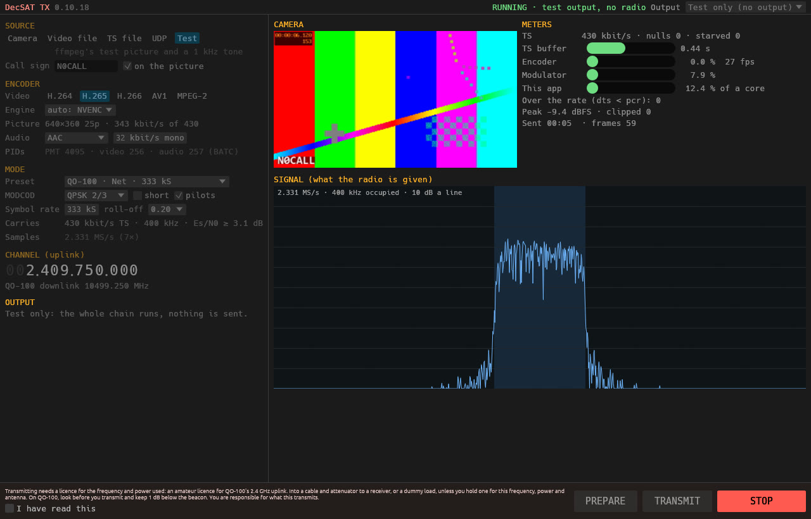

<!-- made by CasualArclamp -->
# DecSAT manual: Transmit

This page describes the transmit panel and the `decsat-tx` application. [Back to the README](../../README.md).

## Transmitting (DVB-S2/S2X DATV)

**Tools ▸ 📡 Transmit…** opens the transmit panel. The panel sends an
MPEG-TS on a DVB-S2 or S2X carrier, to the HackRF or to an IQ file. While
DecSAT transmits, a red **📡 Transmitting** button shows at the right of the
menu bar.

- **Source:** one of these:
  - A `.ts` file. DecSAT plays it at its own rate, which it reads from the
    PCRs of the file. You can set it to loop.
  - A UDP stream (raw TS or RTP, as ffmpeg or OBS send it:
    `ffmpeg … -f mpegts udp://127.0.0.1:1234`).
  - The test stream of DecSAT.

  DecSAT fills the part of the channel that the input does not use with
  null packets.
- **Carrier:** any DVB-S2 MODCOD (normal or short frames) or S2X data
  MODCOD, pilots, roll-off 0.35–0.05, symbol rate, PL gold code. The panel
  shows the TS rate that the channel carries, the bandwidth and the sample
  rate (4 samples a symbol where it fits, 2–20 MS/s).
- **Output:** the HackRF at a frequency, or an IQ file (`.cs8`, `.cs16`,
  `.cf32`) written in real time.

**The HackRF transmits only when you tick Armed and push Transmit.**

- The TX gain starts at 0 dB and the +14 dB amplifier starts off each time.
  DecSAT does not keep these two settings.
- DecSAT never sets the antenna power to on.
- Stop sets the radio back to off. So does the closure of the panel or of
  the program.
- The HackRF cannot receive and transmit at the same time. Thus Transmit
  stops a HackRF receive session. Start the receive session again after the
  transmission.
- The function is for a cable and an attenuator into a receiver, or for a
  dummy load. To radiate, you must have a licence for the frequency and the
  power.

From the command line, to a file:

```bash
decsat tx --ts video.ts --loop --modcod "8PSK 3/4" --symbol-rate 1000000 --out tx_4000000Sps.cs8 --seconds 30
```

## The transmitter app (`decsat-tx`): a webcam on QO-100



`decsat-tx` is a separate program, adjacent to the receiver. (DecDVB-T also
has its own transmitter.) It does these steps:

1. It takes a **camera and a microphone**. It can also take a video file,
   a `.ts` file, a UDP stream or the test pattern.
2. **ffmpeg encodes the input live** into a transport stream at exactly
   the rate of the channel.
3. It puts the transport stream on a **DVB-S2/S2X carrier**.
4. It sends the carrier to the HackRF One or to an IQ file.

The program must have `ffmpeg` (on the PATH, adjacent to the exe, or
`winget install Gyan.FFmpeg`). Its own settings are in
`%APPDATA%\DecSAT-TX\prefs.txt`.

- **Video:** H.264, **H.265/HEVC**, **H.266/VVC**, **AV1** or MPEG-2.
  - The program uses the encoder of the graphics card where there is one
    (NVENC, AMF, Quick Sync: auto selects the first that operates).
  - If not, it uses the CPU (x264, x265, vvenc, SVT-AV1).
  - The picture size follows the rate (640×360 for H.265 at the 333 kS of
    QO-100).
  - VVC is limited to 480×270, because vvenc uses approximately two cores
    even at that size.
  - **AV1** goes as the AOM document "Carriage of AV1 in MPEG-2 TS"
    (v1.0.1) specifies. ffmpeg cannot do that mapping. Thus DecSAT writes
    it (`decsat_ts::av1`), and the player of DecSAT reads it back. Most
    DATV receivers will not play AV1.
- **Audio:** AAC or MP2, mono. The program shows the level of the
  microphone.
- **QO-100 presets** from the 2021 bandplan (V3) of BATC / AMSAT-DL:
  - The net (10499.25 MHz, 333 kS).
  - The 14 narrow slots at 333/250 kS (the lower 9 at 500 kS).
  - The very narrow 125/66/33 kS slots.
  - The wide 1000/1500 kS channels.
  - The conference frequency.

  The presets use QPSK 2/3 (1/2 for very narrow), roll-off 0.20, pilots on
  and normal frames. You enter the uplink (2401–2410 MHz), and the program
  shows the downlink. The program flags a frequency or a rate that the
  bandplan does not permit. The PIDs are as BATC requests: PMT 4095, video
  256, audio 257. The service name is your call sign, which the program
  can also put on the picture. Each preset value cites its source in
  `crates/decsat-tx/src/qo100.rs`.
- **CPU load** (Ryzen 7 4800H, RTX 3050, the webcam at approximately
  640×360, the net preset; % of one core):
  - ffmpeg with H.265 on NVENC: 15.
  - H.264 on NVENC: 10.
  - x264: 21.
  - x265: 31.
  - SVT-AV1: 40.
  - MPEG-2: 3.
  - vvenc: 180.
  - The app itself: approximately 10 (the modulator 8) while it draws.

**The HackRF transmits only after you do these three steps: tick "I have
read this", push ARM, and push TRANSMIT.** ARM is good for 60 s and for one
transmission. It lapses when the window loses focus.

- Each start is on the "Test only" output, with TX VGA 0 dB and the
  amplifier off. The program does not keep these settings.
- The program never sets the antenna power to on.
- Stop (or Escape, or Space) sets the radio back to off. So does the
  closure of the window or of the program.
- If a receive session holds the HackRF (the session of DecSAT, or that of
  a different program), you must stop it first. The app tells you. It does
  not touch other programs.
- The app is for a cable and an attenuator, or for a dummy load, unless you
  have a licence for the uplink of QO-100.
- On the satellite, look before you transmit. Keep your signal 1 dB below
  the beacon.

Checks without a radio (these commands cannot get access to the radio):

```bash
decsat-tx --source camera --codec h265 --sink iq:tx_2331000Sps.cs8 --start --run-secs 10   # prints the CPU
decsat decode tx_2331000Sps.cs8 --decoder ts --symbol-rate 333000 --fast --out rx.ts
cargo run --release -p decsat-ts --example av1_ivf -- rx.ts/….ts av1.ivf   # an AV1 stream out of a TS, for ffmpeg
cargo run --release -p decsat-modem --example aptx_wav -- rx.ts/….ts wavs   # Enhanced apt-X services of a TS, a .wav each
```
